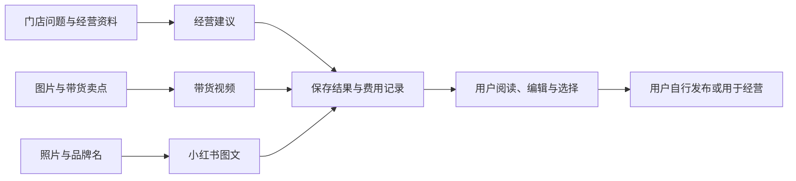

# 2026-09-05 项目简化与第二轮技术迭代

## 从用户结果反推项目

餐饮老板使用这个项目，是为了获得经营建议、带货视频或小红书图文。岗位数量、技能档案、生成模型和定时流程都是实现手段，不应成为第一次取得结果之前必须理解或配置的步骤。

当前项目的有效主链是：提供门店问题或照片 → 选择交付物 → 按实际需求调用能力 → 保存原文或成片 → 展示费用 → 用户决定是否采纳和发布。数据管理、企业知识、账号权限和历史任务为这条链提供支持。

上一轮已修复的失败原因、真实云调用和本地媒体证据见[修复验收](2026-09-05-delivery-verification.md)及[失败归因](2026-09-05-failure-audit.md)。本轮继续删除妨碍主链的机制，不把“隐藏”或“写了建议”当作已经删除代码。

## 本轮决定与落实范围

| 原设计或实现 | 处理 | 用户能感受到的变化 |
| --- | --- | --- |
| 新老板空首页显示充值、任务、客户、派活等八步清单 | 删除这份默认清单，改为三个受权限控制的业务入口 | 直接进入经营建议、带货视频或小红书的实际输入界面 |
| “我的智能体”与现成员工并列一级导航 | 合并为员工页的自定义入口，保留原地址及工作流导入导出 | 默认导航减少一项，自定义能力仍可找到 |
| 带货卡片既有“单独派活→工作台→打开任务”，又有直达按钮 | 合并重复主动作，直接打开专用面板 | 少经过一层中转窗口 |
| 工具箱把定时规则表单、立即自动运行和单次运行同时展开 | 定时配置按需展开，保留已有规则状态 | 第一次运行先填写本次需求，不会误以为必须配置自动化 |
| 旧派活步骤与说明被CSS永久隐藏，组件和首次提示逻辑仍运行 | 删除不可见节点及专用状态、存储和滚动逻辑 | 只维护当前实际可见的派活界面 |
| 原生专用岗位仍加载通用任务，关闭的视频面板恢复缓存并轮询 | 删除不适用加载；只在实际打开时恢复并查询 | 不为隐藏面板重复查询，后台任务照常运行 |
| 已取得安全完整草稿，仍耗尽三轮后才交付备用候选 | 前移已有安全判定，通过即交付；删除预算耗尽后回退机制 | 首轮可交付时不再多等两轮、不再为这两轮付费 |
| 复盘返工提示把测试数字当成本次任务事实 | 删除固定数字特例 | 返工依据仅来自真实输入和本次校验信息 |
| 用户不采纳被归为失败或强制返工，洞察统计也计入失败 | 不采纳成为独立终态，单列统计，原稿和费用保留 | 不采纳不等于生成故障，也不要求重新付费生成 |

## 保留什么，为什么

- **保留已有员工能力和岗位来源。** 没有使用数据支持直接删除某个专业岗位；本轮减少的是默认选择负担和重复入口。
- **保留可达的图片、视频、PPT能力。** 它们仍被模板和岗位调用，不能因主导航隐藏就当成死代码删除。
- **保留经营数据、客户、活动、素材、知识库、账号权限。** 这些为门店业务和生成结果提供真实上下文，不能仅凭页面较多就删除数据模块。
- **保留已启用的定时规则。** 用户已有计划不被暂停；调整默认展示不修改规则或触发额外运行。
- **保留失败证据、原稿、账目、用户选择和外发授权。** 不通过删除账目、回写旧结果或取消必要权限来制造“全部成功”。

本轮不新建自动化、不重做整个技术架构，也不以文件行数作为删除目标。只有确认无用途、重复或违背用户结果的部分才删除。

## 验证口径

需要同时确认：三个首页入口实际到达输入界面；权限不足不会进入付费派活；关闭视频面板不再轮询；隐藏说明没有残余依赖；安全首轮只有一次调用；不采纳仍可读回原稿、费用不变，且不计入失败或待处理。

本轮实现与验证已完成：

- 全量自动化：**2280项，2279通过、0失败、1跳过**。跳过的是缺少运行环境的DOCX全页视觉渲染，OOXML契约仍执行。日志：`/private/tmp/nanowork-first-principles-all-tests.log`。
- 新界面与岗位工作台专项36/36；首页、导航、自动化和自定义员工专项27/27；经营洞察、状态展示及发布权限专项58/58。
- 浏览器8项通过：[详细请求计数与证据](../../artifacts/acceptance-2026-09-05/first-principles-ui.json)。关闭带货窗口后的查询计数保持不变；专岗通用runs请求为0；两个深链直达专用面板；不采纳原文与复制入口保留；旧图片模板仍可使用。测试使用隔离模拟接口，没有新增真实生成或费用。
- 前端typecheck、strict lint、format、设计token、UI契约、生产构建均通过；隔离检查退出码0，保留35处现存外键关联读取提示；`git diff --check`通过。
- 本机服务已加载新代码：`http://127.0.0.1:3107/`，2026-09-05 09:54 UTC健康检查`ok=true, db=up`，进程81414，首页引用本轮构建`index-BdDaaW6A.js`。未登录小红书任务API返回401。沙箱内静态页读取被拒绝后，在沙箱外成功核对构建版本。
- 重启前再次确认运行任务为0；原数据库一致性备份：`artifacts/acceptance-2026-09-05/preview-backup/nanowork-preview-before-simplification-1788601950331.db`，权限0600。原托管服务自动重启，既有定时规则与运行配置保持原样。

上述为代码回归、浏览器行为和本机运行验收。本轮未新增付费云调用；完整真实云流程、Windows实机与签名发布的剩余范围沿用上一份验收记录，没有被本地通过数替代。
